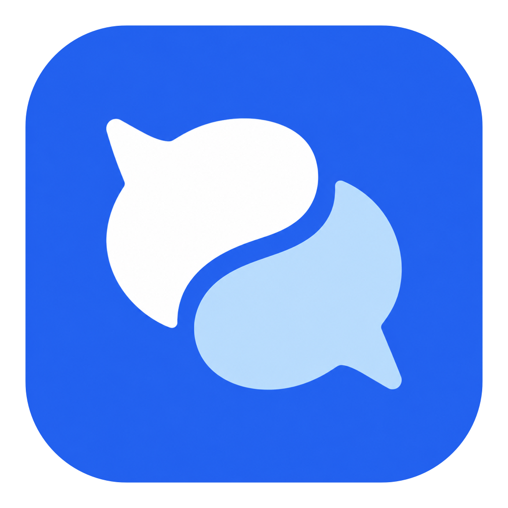
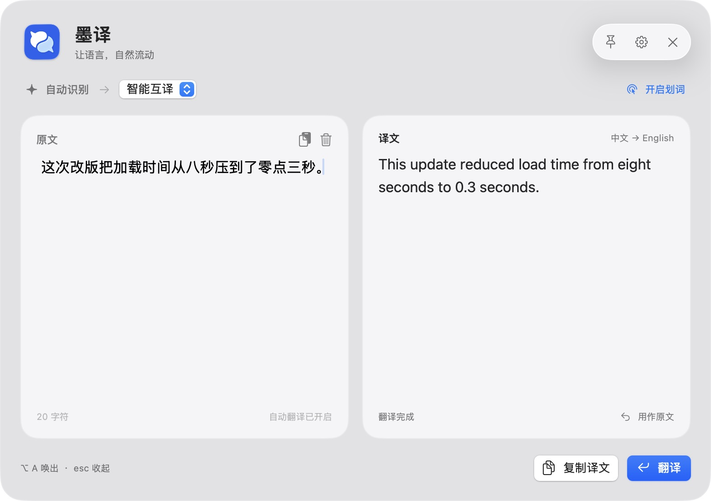
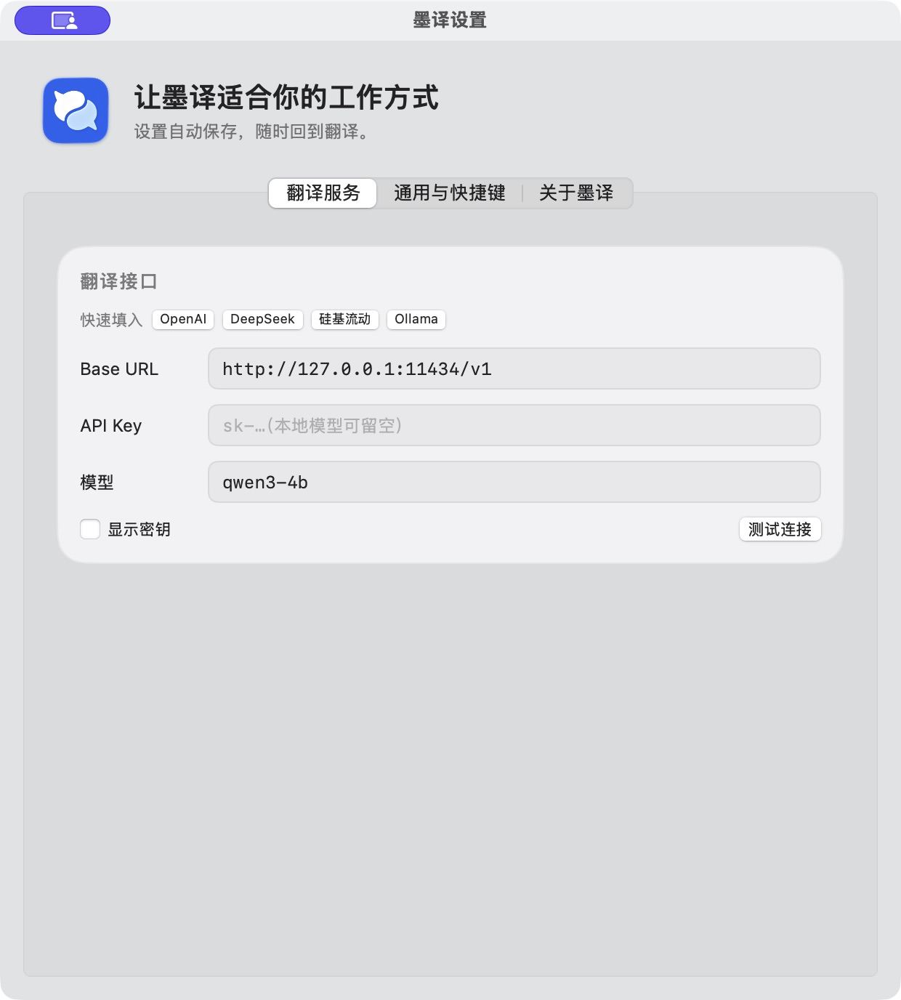
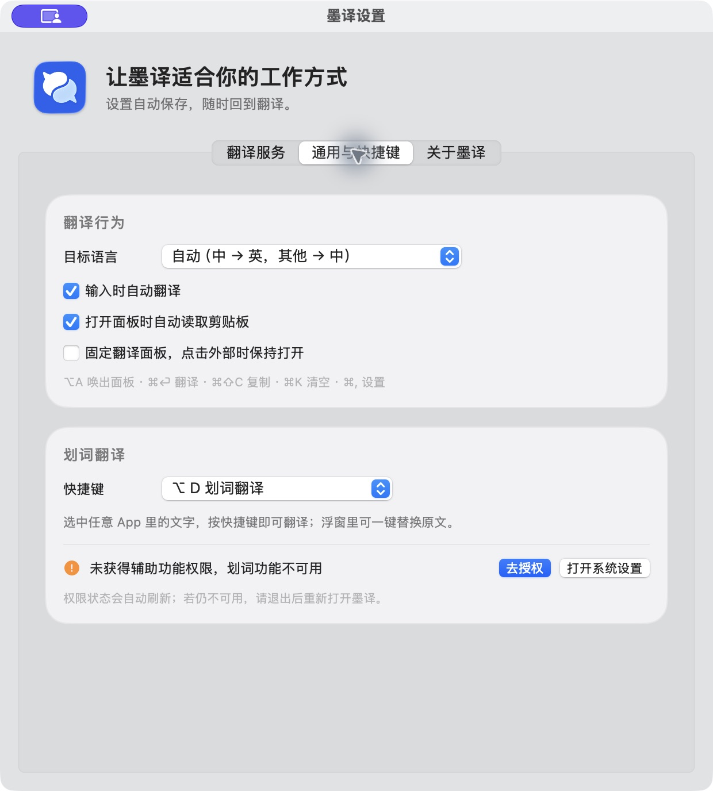
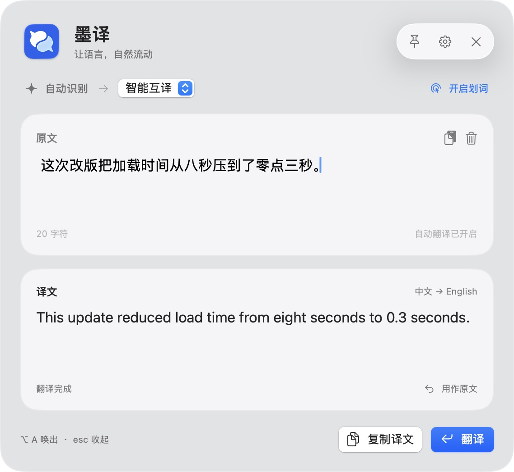

<p align="center"></p>

# 墨译 MoTranslate — 原生 macOS AI 翻译器

**简体中文** · [English](README.md) · [日本語](README.ja.md)

墨译是一款使用 **SwiftUI / AppKit** 开发的 **Mac 菜单栏翻译工具**。支持输入、粘贴和划词翻译，可连接 **Ollama 本地大模型**，也可使用兼容 **Chat Completions** 的接口。用快捷键唤出面板，左右对照原文与译文，再把结果复制回工作中。

**macOS 14+ · Apple Silicon 预编译版本 · SwiftUI / AppKit · MIT 开源许可**



*以上为实际运行截图，使用合成示例文本。当前界面为简体中文；中、英、日三种语言的说明文档不代表界面已经完成三语本地化。*

## 可以做什么

- **本地 AI 翻译**：连接本机 Ollama，模型下载完成后可在不调用云端翻译服务的情况下推理。
- **划词翻译与替换**：在其他应用中选中文字，按 **⌥D** 查看浮窗；在目标应用支持的情况下，可以复制译文或替换选区。需辅助功能权限。
- **快捷键操作**：**⌥A** 唤出，**⌘Return** 翻译，**⌘⇧C** 复制，**⌘K** 清空。
- **适合 Mac 的面板**：支持窗口缩放、左右或上下布局、图钉固定、多显示器定位。macOS 26+ 使用系统 Liquid Glass 控件，较早的受支持系统使用原生材质回退。
- **内置模型目录与自有模型库**：添加模型时可从内置目录选择 Ollama、DeepSeek、OpenAI、Anthropic、Gemini、Kimi、智谱、通义、硅基流动、OpenRouter，选中即填好 Base URL 与模型代号，通常只需再填 API Key。目录核对自 [models.dev](https://models.dev)（2026-10）。只有你添加过的模型会出现在翻译面板和峰谷选择里。
- **一键部署**：构建、备份旧版、安装、创建桌面替身、固定 Dock，并启动应用。
- **请求状态管理**：自动翻译采用 700ms 防抖；支持停止、重试，修改文本或目标语言时使旧请求失效。
- **长文本分段与 Markdown 渲染**：长输入按 Markdown 结构切分，代码块原样保留，逐段串行翻译；面板底部可随时开关分段，译文逐段出现。译文区会渲染标题、加粗、斜体、列表、引用和代码块，不再显示 `**` 这类标记。流式输出默认开启，可边生成边显示，也能关闭以兼容不支持流式的接口。Markdown 识别默认开启，可在设置里关闭。
- **翻译风格**：自然、严谨、大白话、口语、精简 + 总结五种风格，在主面板直接切换，切换后自动重译。
- **峰谷分时切换模型（默认关闭）**：高峰时段用本地模型、空闲时段用云端模型；高峰时段与周末规则可编辑。只按你设置的时钟规则切换，不代查服务商计费。

## 安装

### 方式一：下载预编译应用

1. 前往 [Releases](https://github.com/MoYu2008Fish/motranslate-macos/releases)，下载 `MoTranslate-macos-arm64.zip`。
2. 解压，把 `MoTranslate.app` 放进「应用程序」，然后打开。
3. 按 **⌘,** 打开设置，配置本地模型或你自己的兼容接口。应用不附带模型和服务商密钥。

此版本面向 **Apple Silicon**，未提供 Intel 预编译包。应用为本地 ad-hoc 签名，**尚未公证**；若系统要求审核，请遵循 macOS 正常的安全提示。部署目标为 macOS 14+，目前实际截图和运行检查来自 macOS 26；macOS 14/15 与 27 尚未进行运行验证。

### 方式二：从源码一键部署

需要 **Xcode 26+ 或对应的 Command Line Tools，包含 macOS 26+ SDK**。

```sh
git clone https://github.com/MoYu2008Fish/motranslate-macos.git
cd motranslate-macos
./deploy.sh
```

也可以在 Finder 中双击仓库内的 **`一键部署墨译.command`** 或 **`Deploy MoTranslate.command`**。

脚本会更新 `/Applications/MoTranslate.app`，在桌面创建「墨译」Finder 替身，添加或更新一个 Dock 固定入口，最后启动。桌面和 Dock 指向同一份安装，重复部署不会重复添加入口，其他 Dock 应用及排列会保留。刷新图标时 Dock 会短暂重启。请以当前桌面用户运行，**不要使用 sudo**。

若 `/Applications` 不可写且其中没有旧版，会改用 `~/Applications`。桌面存在同名无关文件时，部署会停止，不覆盖该文件。

```sh
./build.sh release                    # 仅构建
./deploy.sh --no-build                # 部署已经构建的版本
./deploy.sh --no-build --no-launch    # 部署后不启动
```

旧应用以 ZIP 备份，桌面替身和 Dock 固定应用配置也会备份到：

```text
~/Library/Application Support/MoTranslate/DeploymentBackups/
```

## 配置本地模型



1. 启动本机 Ollama，运行 `ollama list`，确认已经下载的模型及其完整名称。
2. 按 **⌘,** 打开「翻译服务」，Base URL 填 `http://localhost:11434/v1`。
3. 本地 Ollama 的 API Key 可留空，模型栏填写你机器上的准确模型名称。
4. 点击「测试连接」，成功后关闭设置，在面板中输入文字。

截图中的 `qwen3-4b` 是本机别名，不一定与你的名称相同。Ollama 预设只是可编辑示例，不会自动下载模型，也不代表模型已安装。[本地模型实测报告](benchmarks/README.md) 提供统一样例、原始输出、耗时和适用边界，可用于选择主用模型与轻量备选。

### 远程接口

填入服务商的兼容 Base URL、准确模型 ID 和密钥。以 `/v1` 结尾的地址会补上 `/chat/completions`；仅填写主机地址时会补上 `/v1/chat/completions`；完整的 `/chat/completions` 地址可直接使用。当前不实现仅支持 Responses 的接口或其他不兼容协议。

### 本机实测建议

开发机为 M1 Max、64 GB。每个模型用同一组 12 条合成样例比较后，日常主用推荐本机的 **Qwen3-4B-Instruct-2507 Q4_K_M**（别名 `qwen3-4b:latest`），平均响应 **0.62 秒**。Gemma4 26B 在部分句子中更自然，但平均 **18.69 秒**；1.7B 可作较小备选，0.6B 出现含义遗漏。这里比较的是本机已安装配置，包含不同变体和推理后端，不是通用速度排行；译文质量由 Luna medium 主观评审。详见[原始译文与限制](benchmarks/REPORT.md)。

## 实际操作

1. 按 **⌥A** 唤出面板，输入或粘贴原文。
2. 自动翻译开启时，停止输入后稍等；也可按 **⌘Return** 或点击「翻译」。单独按 Return 可以换行。
3. 「智能互译」采用中文 → 英文、其他识别语言 → 中文的策略；也可以固定目标为中文或英文。
4. 点击「复制译文」或按 **⌘⇧C**，再粘贴到需要的位置。
5. 点击右上角图钉，可以在切换到其他应用时保留面板。

**当前目标语言选项为中文和英文。** 引擎会识别其他源语言，但短文本和混合文字可能存在歧义；当前界面不是任意目标语言的多语种翻译器。

| 操作 | 快捷键 |
| --- | --- |
| 唤出 / 收起面板 | ⌥A |
| 划词翻译 | 默认 ⌥D，可在设置中更改 |
| 翻译 | ⌘Return |
| 复制译文 | ⌘⇧C |
| 清空输入 | ⌘K |
| 设置 | ⌘, |
| 收起面板 | Esc / ⌘W |

### 划词翻译需要什么权限



在「系统设置 → 隐私与安全性 → 辅助功能」中为墨译授权。普通输入、粘贴翻译不需要此权限。并非所有应用都暴露可读、可编辑的选区，模拟复制与粘贴属于尽力回退。迁移或重编译后可能需要重新添加应用。截图展示的是未授权状态；本次没有录制跨应用替换成功的演示。

### 窄屏布局



拖动边缘调整窗口大小。宽窗口左右对照，窄窗口上下排列，界面跟随系统深浅色和「降低透明度」设置。

## 隐私与常见问题

- **文本发到哪里？** 发到你配置的接口。本地 Ollama 配合已下载模型可在本机推理；远程接口会收到文字和配置的认证信息。密钥在 Keychain，其他偏好在 UserDefaults。详见 [SECURITY.md](SECURITY.md)。
- **没有译文？** 先检查服务是否启动、模型名称是否准确、接口是否兼容，再看「测试连接」返回的信息。模型需要单独下载。
- **本地模型很慢？** 首次加载可能较慢。回环地址最多等待 180 秒，其他接口为 60 秒。可以停止、重试或选择较小模型；耗时与硬件、量化、上下文及思考模式有关。
- **快捷键无效？** 退出其他路径下的墨译，并检查与现有快捷键的冲突。主面板快捷键固定，划词快捷键提供预设。
- **不能替换原文？** 检查辅助功能权限和目标应用是否提供可编辑选区，不能保证所有应用都能替换。

## 开发与验证

```sh
swift test
swift tools/deploy.swift --self-test
./build.sh release
```

部署助手自测只使用临时替身和内存中的 Dock 测试数据，不会安装应用或修改真实 Dock。CI 在 macOS 26 上构建。项目没有额外的 Swift 包依赖。

欢迎提交 [问题反馈](https://github.com/MoYu2008Fish/motranslate-macos/issues) 或 [参与开发](CONTRIBUTING.md)。

[操作指南](docs/usage.md) · [本地模型评测](benchmarks/README.md) · [图标来源与提示词](docs/icon-design.md) · [MIT 许可](LICENSE)

**相关关键词：** Mac 翻译器、macOS 翻译软件、菜单栏翻译、划词翻译、选中文字翻译、剪贴板翻译、本地大模型翻译、Ollama 翻译、离线翻译、中英互译、AI translator、OpenAI-compatible API、SwiftUI、AppKit、Apple Silicon、Liquid Glass。
